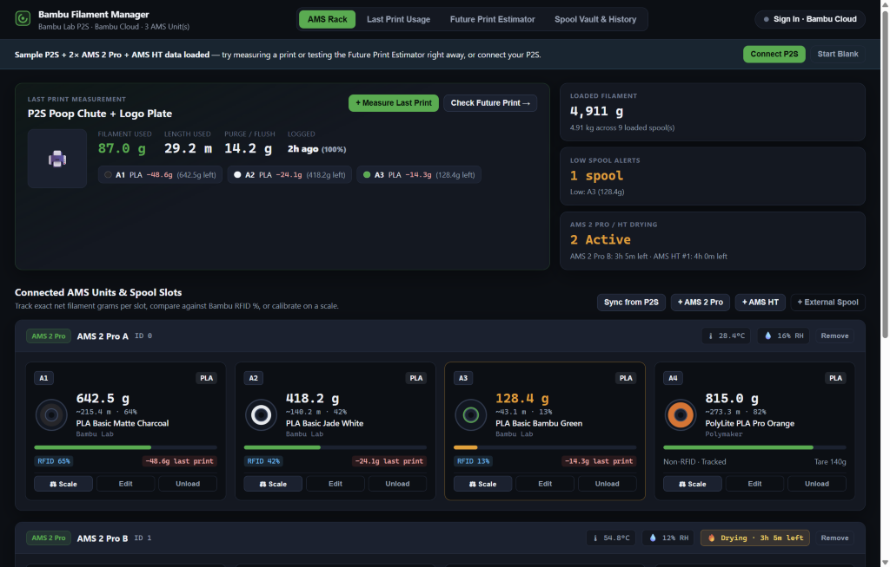
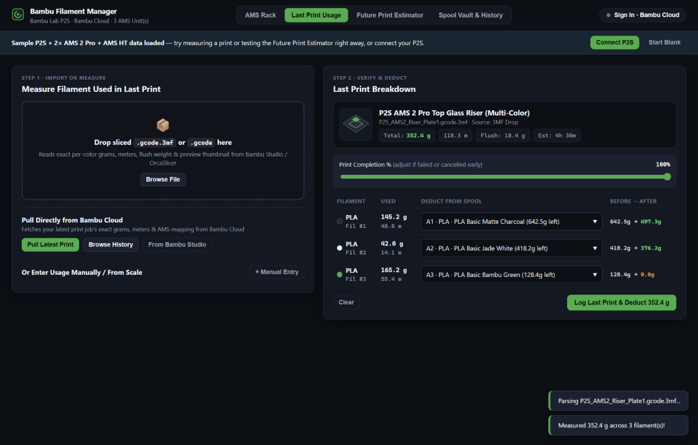
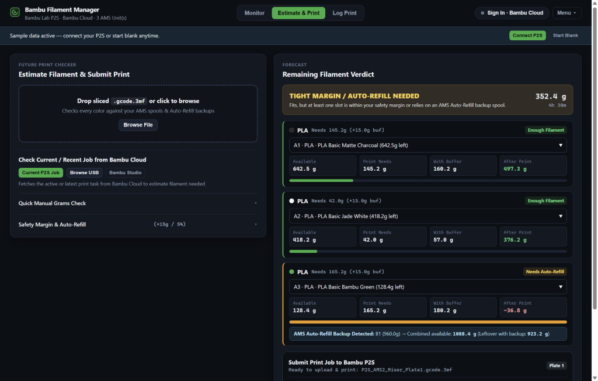

# Bambu Lab P2S · AMS 2 Pro / AMS HT Filament Manager

A zero-install Windows web dashboard for tracking filament usage across multiple **AMS 2 Pro** and **AMS HT** units on your **Bambu Lab P2S** — measuring how much filament your **last print** used, estimating whether your remaining spools can finish a **future print**, and uploading/submitting print jobs directly to your printer.

---

## Screenshots

### Multi-AMS 2 Pro / AMS HT Rack & Last Print Summary

### Last Print Usage Measurement (`.gcode.3mf` Breakdown & Deduction)

### Future Print Estimator ("Will It Fit?"), AMS Auto-Refill Check & Print Submission

---

## Features

- **Zero-Install Windows Runtime:** Runs locally using built-in Windows PowerShell, .NET, and `curl.exe` — no Python, Node.js, or external packages required.
- **Multi-AMS 2 Pro & AMS HT Support:** Tracks multiple 4-slot **AMS 2 Pro** units (`A1–A4`, `B1–B4`, etc.), single-slot **AMS HT** units (`HT-1+`, `ams_id` `128+`), and an **External Spool**.
- **Full Non-RFID & RFID AMS Reading:** Reads live AMS temperature, humidity, active drying countdowns, loaded vs. empty slots, material, exact hex color, decoded Bambu filament profiles (`GFA00`, `GFL99`, etc.), nozzle temp ranges, and active-in-nozzle status (`tray_now`) over local MQTT — even for non-RFID third-party spools.
- **Collapsible Live Chamber Camera View:** Click **📷 Live View** in the Monitor bar to stream your P2S live camera via local RTSPS (`port 322` using auto-detected `ffmpeg`, or `port 6000` JPEG on P1/A1 printers) with live print HUD overlay, FPS selector, snapshot download, fullscreen, chamber light toggle, and automatic stream shutdown when collapsed. *(On the P2S touchscreen, enable **LAN Mode Liveview** to open RTSPS port `322`.)*
- **Hands-Free Auto-Deduct on Print Finish:** Automatically detects when your P2S finishes (or stops) a print via MQTT, pulls the matching `.gcode.3mf` from P2S USB FTPS (or local Bambu Studio cache fallback), matches each filament to its AMS 2 Pro / AMS HT slot, deducts exact grams (scaled proportionally if cancelled early), and updates totals with zero input—even if your browser tab is closed (with 1-click **Undo** in the confirmation banner or Print History).
- **Last Print Usage Measurement:**
  - Pull `.gcode.3mf` files directly from your P2S **External USB** drive over FTPS (`port 990`).
  - Pull sliced plates directly from your local **Bambu Studio** / **OrcaSlicer** cache (**From Bambu Studio**).
  - Drag & drop any `.gcode.3mf` or `.gcode` file to extract exact per-color grams, meters, flush/purge weight, and plate preview thumbnail from `Metadata/slice_info.config`.
  - Supports partial/failed print completion `%` scaling, kitchen-scale tare calibration (**⚖ Scale**), and 1-click **Undo Deduction** in Print History.
- **Future Print Estimator ("Will It Fit?"):**
  - Checks any upcoming `.gcode.3mf`, current active P2S job (with a **Remaining % only** toggle), or manual gram estimate against your loaded AMS spools.
  - Configurable safety buffers (`+g` and `+%`), projected leftover grams per slot, and automatic **AMS Auto-Refill** backup spool detection.
- **Direct Print Upload, Submission & Live Controls:**
  - Upload `.gcode.3mf` files to the P2S External USB drive via FTPS and optionally start prints directly via MQTT `project_file` (with multi-AMS `ams_mapping` + `ams_mapping2`, bed leveling, vibration/flow calibration, and timelapse options).
  - Live **Pause / Resume / Stop** controls in the top printing bar.
- **Private Local Storage:** All printer credentials, spools, and print history stay locally on your PC in `data/filament_db.json` (excluded from Git via `.gitignore`).

---

## Quick Start

1. Clone or download this repository.
2. Double-click **`Start-FilamentManager.bat`**.
3. Your browser opens `http://127.0.0.1:8765/` automatically.

---

## How to Set Up & Use

### 1. External USB Flash Drive Setup (for P2S FTPS File Access)
On the **Bambu Lab P2S**, prints sent to the printer's small internal model cache are **not** exposed over FTPS (`/` appears empty unless external USB storage is attached).

1. Plug a **FAT32-formatted USB flash drive** directly into the P2S USB port (avoid USB hubs).
2. When sending prints from Bambu Studio, choose **External Storage** (or upload files using this app's **Upload Only to USB** button).
3. Once files are on the USB drive, **Pull Latest Print**, **Browse History**, **Check Current P2S Job**, and **Browse Jobs** automatically discover and download your `.gcode.3mf` files over FTPS (`port 990`).
4. *No USB drive?* You can still slice a plate in Bambu Studio and click **From Bambu Studio** (reads your local slicer cache) or drag-and-drop an exported `.gcode.3mf` directly into the app.

### 2. Connecting Your Bambu Lab P2S
1. Click the connection pill in the top-right corner to open **Settings** and select **Local LAN Mode**.
2. Enter your P2S details from the printer touchscreen:
   - **IP Address** & **8-character Access Code** (**Settings → WLAN / Network**)
   - **Serial Number (SN)** (**Settings → Device**)
3. Click **Save & Connect**, then click **Sync from P2S** on the **AMS Rack** tab.
4. Your connected **AMS 2 Pro** / **AMS HT** units, live temps/humidity, loaded vs. empty slots, colors, and filament profiles will populate automatically.

### 3. Tracking Non-RFID Spools (Kitchen Scale Calibration)
The P2S broadcasts material, color, profile (`GFA00`, `GFL99`, etc.), and temperatures for **non-RFID** spools, but cannot measure remaining weight optically (`remain: -1`).
1. Click **⚖ Scale** on any loaded spool card.
2. Enter the **Gross Weight** (spool + filament) from a kitchen scale and confirm the **Empty Spool Tare Weight** (built-in presets for Bambu Reusable 250g, Bambu High-Temp 255g, Polymaker/Cardboard 140g, Sunlu 130g, eSUN 190g, or custom).
3. The app locks in exact net filament grams remaining and tracks every subsequent print from there.

### 4. Measuring Last Print Usage & Estimating Future Prints
- **After a print finishes (`Last Print Usage` tab):** Click **Pull Latest Print** (or **Browse History** / **From Bambu Studio** / drag-and-drop `.gcode.3mf`). Verify the auto-matched AMS slots, adjust the **Completion %** slider if a print stopped early, and click **Log Last Print & Deduct**.
- **Before starting a print (`Future Print Estimator` tab):** Drop your next `.gcode.3mf` or click **Check Current P2S Job** / **Browse Jobs**. Review the **Ready to Print / Tight Margin / Not Enough Filament** verdict, projected leftover grams, and any **AMS Auto-Refill** backup slot matches.

### 5. Submitting Print Jobs from the App (Two Modes)
In the **Future Print Estimator** tab, after checking a `.gcode.3mf` file and verifying your AMS slot mapping, use the **Submit Print Job to Bambu P2S** panel at the bottom of the forecast.

Because Bambu Lab P2S firmware enforces Authorization Control on local MQTT write commands (`project_file`, `pause`, `resume`, `stop`), choose the workflow that matches how you use your printer:

#### Option A — Start / Pause / Stop Prints Directly from the App (Developer Mode)
1. On your P2S touchscreen, go to **Settings → LAN Only Mode**.
2. Enable **LAN Only Mode**, then toggle on **Developer Mode** right below it *(note: Bambu requires LAN Only Mode to turn on Developer Mode, which disconnects Bambu Handy cloud remote control while enabled)*.
3. In the app, click **🖨 Start Print on P2S** to upload (if local) and immediately start printing with your chosen AMS slots and calibration options.

#### Option B — Keep Bambu Handy / Bambu Cloud Connected
1. Leave **Developer Mode** off on your P2S.
2. In the app, use **Upload Only to USB** (FTPS uploads still work without Developer Mode).
3. Tap the uploaded `.gcode.3mf` file on the P2S touchscreen to start printing — while keeping full live AMS 2 Pro telemetry, Bambu Handy access, and automatic `.gcode.3mf` filament tracking.

---

## Project Structure

- `Start-FilamentManager.bat` — Double-click Windows launcher
- `server.ps1` — Local HTTP server, REST API, and local JSON datastore (`data/filament_db.json`)
- `BambuEngine.cs` — Embedded C#/.NET engine (TLS MQTT client, FTPS client, `.gcode.3mf`/`.gcode` parser, Bambu Studio cache scanner, and non-admin `TcpListener` HTTP server)
- `web/` — Frontend dashboard (`index.html`, `styles.css`, `app.js`)
